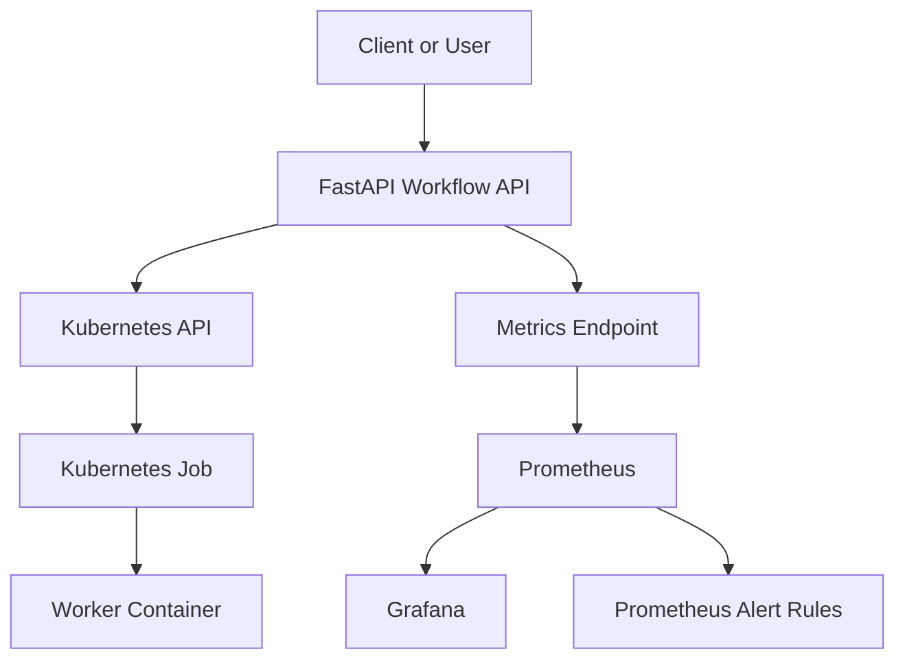

# Kubernetes Workflow Observability Platform

A Kubernetes-native platform for submitting and tracking machine-learning workloads through a FastAPI service. Kubernetes Jobs execute worker tasks, while Prometheus and Grafana provide application monitoring and observability.

> **Project status:** The API, Kubernetes Job execution, automated tests, CI workflow, Prometheus configuration, Grafana deployment, and API alert rules have been implemented. Job-level Prometheus metrics are still a work in progress and should not be considered available until they are integrated and verified.

## Table of contents

- [1. Overview](#1-overview)
- [2. Architecture](#2-architecture)
- [3. Features](#3-features)
- [4. Technology stack](#4-technology-stack)
- [5. Repository structure](#5-repository-structure)
- [6. Prerequisites](#6-prerequisites)
- [7. Set up the project locally](#7-set-up-the-project-locally)
- [8. Run and explore the API](#8-run-and-explore-the-api)
- [9. API reference](#9-api-reference)
- [10. Run tests and code checks](#10-run-tests-and-code-checks)
- [11. Deploy to Kubernetes](#11-deploy-to-kubernetes)
- [12. Monitoring and alerting](#12-monitoring-and-alerting)
- [13. Troubleshooting](#13-troubleshooting)
- [14. Security and production considerations](#14-security-and-production-considerations)
- [15. Roadmap](#15-roadmap)
- [16. License](#16-license)

## 1. Overview

The platform provides an HTTP API for submitting training and inference tasks. When a request is accepted, the API creates a Kubernetes Job that runs a worker container. Clients can list jobs and retrieve their status through the API.

The API exposes a `/metrics` endpoint for Prometheus monitoring. Kubernetes manifests are included for the API, role-based access control (RBAC), Prometheus, Grafana, and Prometheus alert rules.

## 2. Architecture



### Request lifecycle

1. A client submits a task to the FastAPI service.
2. The API validates the request and creates a Kubernetes Job.
3. Kubernetes schedules the Job and runs the worker container.
4. The client checks the job list or a specific job's status through the API.
5. Prometheus scrapes the API's metrics endpoint, and Grafana can visualize the metrics that are available.

## 3. Features

- REST API for health checks, job submission, job listing, and job status lookup.
- Kubernetes Jobs for isolated worker execution.
- Support for `training` and `inference` task types.
- Job metadata including task type, parameters, and submission timestamp.
- HTTP request instrumentation exposed through Prometheus.
- Kubernetes manifests for the API and monitoring components.
- Prometheus alert rules for API availability, error rate, and latency.
- Grafana deployment for monitoring visualization.
- Unit and integration tests.
- Automated linting and test execution in CI.

## 4. Technology stack

| Area | Technologies |
|---|---|
| API | Python, FastAPI, Uvicorn |
| Workload execution | Kubernetes Jobs, Kubernetes Python client |
| Containers | Docker |
| Metrics | Prometheus, `prometheus-client` |
| Dashboards | Grafana |
| Quality | pytest, Ruff |
| Local Kubernetes | Minikube or another compatible Kubernetes cluster |

## 5. Repository structure

```text
.
├── app/
│   ├── main.py
│   └── services/
│       ├── kubernetes_jobs.py
│       └── job_metrics.py
├── k8s/
│   ├── api-deployment.yaml
│   ├── workflow-rbac.yaml
│   └── monitoring/
│       ├── grafana-deployment.yaml
│       ├── prometheus-alerts.yaml
│       ├── prometheus-config.yaml
│       └── prometheus-deployment.yaml
├── worker/
│   └── Dockerfile
├── tests/
│   ├── unit/
│   └── integration/
├── requirements.txt
└── README.md
```

This is the expected high-level layout based on the project structure documented so far. If files have changed, confirm the current layout with:

```powershell
Get-ChildItem . -Recurse -File
```

## 6. Prerequisites

Install the tools needed for the parts of the project you want to run:

- **Python 3.13** — the CI workflow uses Python 3.13.
- **Git** — to clone and manage the repository.
- **Docker** — to build container images.
- **kubectl** — to inspect and manage Kubernetes resources.
- **Minikube or another Kubernetes cluster** — required for Kubernetes-backed job execution.
- **PowerShell** — commands in this guide use Windows PowerShell syntax.

Check your installations:

```powershell
python --version
git --version
docker --version
kubectl version --client
```

Docker and Kubernetes are not required just to install dependencies or run tests that do not need a live cluster. The API's Kubernetes operations do require a working Kubernetes configuration.

## 7. Set up the project locally

### Step 1 — Clone the repository

If you have not cloned the project yet:

```powershell
git clone https://github.com/amityadav108/kubernetes-workflow-observability-platform.git
cd kubernetes-workflow-observability-platform
```

If the repository is already on your computer, open PowerShell in the project directory instead.

### Step 2 — Create a virtual environment

```powershell
python -m venv .venv
```

### Step 3 — Activate the virtual environment

```powershell
.\.venv\Scripts\Activate.ps1
```

If PowerShell blocks activation because of the execution policy, you can activate the environment for the current terminal session with:

```powershell
Set-ExecutionPolicy -Scope Process -ExecutionPolicy Bypass
.\.venv\Scripts\Activate.ps1
```

This changes the policy only for the current PowerShell process.

### Step 4 — Install dependencies

```powershell
python -m pip install --upgrade pip
python -m pip install -r requirements.txt
```

### Step 5 — Run the API

```powershell
python -m uvicorn app.main:app --reload
```

The local API should be available at:

- API base URL: `http://localhost:8000`
- Interactive Swagger documentation: `http://localhost:8000/docs`
- Alternative API documentation: `http://localhost:8000/redoc`
- Prometheus metrics endpoint: `http://localhost:8000/metrics`

Keep the terminal running while you test the API. Press `Ctrl+C` to stop it.

> **Kubernetes note:** Running the API locally does not start a Kubernetes cluster. For job submission to work, configure a running cluster and a kubeconfig that the Kubernetes client can use. The application may use in-cluster configuration when deployed in Kubernetes or local kubeconfig when running outside the cluster.

## 8. Run and explore the API

With the API running, open `http://localhost:8000/docs` in your browser. You can inspect the available endpoints and try requests interactively.

You can also test the health endpoint from a separate PowerShell window:

```powershell
Invoke-RestMethod http://localhost:8000/health
```

Check the metrics endpoint:

```powershell
Invoke-WebRequest http://localhost:8000/metrics
```

The exact response fields depend on the implementation currently in the repository. Examples in the next section illustrate the documented API contract; use the live Swagger page to confirm the current request and response schemas.

## 9. API reference

### `GET /health`

Returns the API health status.

Illustrative response:

```json
{
  "status": "healthy"
}
```

### `POST /jobs`

Submits a worker task as a Kubernetes Job. The endpoint is documented to return HTTP `202 Accepted` when the request is accepted and Kubernetes Job creation succeeds.

Illustrative request:

```json
{
  "task_type": "training",
  "parameters": {
    "epochs": 3
  }
}
```

Illustrative response:

```json
{
  "job_id": "your-job-id",
  "status": "queued",
  "status_url": "/jobs/your-job-id"
}
```

The `job_id` above is an example placeholder, not a real job ID.

Documented task types are `training` and `inference`. The `parameters` field is an optional JSON object. Confirm allowed values and validation rules in the current API schema and worker implementation before relying on a particular parameter.

### `GET /jobs`

Lists workflow jobs managed by the API.

### `GET /jobs/{job_id}`

Returns status and metadata for a specific job. The status depends on the Kubernetes Job state and may include `queued`, `running`, `succeeded`, or `failed`.

### `GET /metrics`

Exposes Prometheus metrics, including HTTP request metrics from FastAPI instrumentation.

**Job-level metrics are not yet verified as fully integrated.** Do not assume submitted-job counters, completion counters, execution-duration histograms, or running-job gauges are available until the lifecycle tracking has been connected to the job service and validated with tests.

## 10. Run tests and code checks

Run commands from the repository root with the virtual environment activated.

### Run the test suite

```powershell
python -m pytest -v
```

For a shorter summary:

```powershell
python -m pytest -q
```

### Run Ruff

If Ruff is installed in the environment:

```powershell
python -m ruff check .
```

If Python reports that Ruff is not installed, install it in the active virtual environment:

```powershell
python -m pip install ruff
python -m ruff check .
```

Run the tests and lint checks again after modifying code. A successful Git push confirms that the commit reached GitHub; it does not by itself prove the application or metrics are functioning correctly.

## 11. Deploy to Kubernetes

The repository includes manifests for the API, RBAC, Prometheus, Grafana, and alert rules. Review the manifests before applying them. The commands below are discovery and verification steps; they do not apply or change cluster resources.

### Step 1 — Confirm Kubernetes is available

```powershell
kubectl config current-context
kubectl get nodes
```

If these commands fail, start or connect to your Kubernetes cluster and check the active context before continuing.

### Step 2 — Inspect the manifests

```powershell
Get-ChildItem .\k8s -Recurse -File
```

Review the API deployment, RBAC, monitoring configuration, namespaces, image names, ports, and service definitions before deployment.

### Step 3 — Check image names and tags

The configuration documented for this project has used:

- API image: `workflow-api:0.3.2`
- Worker image: `workflow-worker:0.1.3`
- Default application namespace: `ml-platform`

Treat these as the last documented values, not a guarantee that every current manifest uses them. Confirm the current values in the manifests and application configuration before building or deploying images.

For Minikube, images must be available to the Minikube node. Follow the image-loading or image-building workflow appropriate to your Minikube setup. The worker configuration has used `imagePullPolicy: Never`, which means Kubernetes will not pull that image from a registry; the image must already be available on the node.

### Step 4 — Apply manifests carefully

After checking the files and ensuring the images, namespace, RBAC, and service configuration match your cluster, apply the relevant manifests in the order required by their dependencies. Use the actual paths present in your repository rather than copying an assumed command.

### Step 5 — Verify the deployed resources

If the namespace is `ml-platform`, inspect the resources with:

```powershell
kubectl get deployments,services,pods -n ml-platform
kubectl get jobs -n ml-platform
```

If your manifests define a different namespace, substitute that namespace. Check pod status and events before trying to submit jobs.

## 12. Monitoring and alerting

### Prometheus

The project includes Prometheus configuration intended to scrape the Workflow API's `/metrics` endpoint and alert rules for:

- `WorkflowAPIDown` — the API target is unavailable to Prometheus.
- `WorkflowAPIHighErrorRate` — the API's HTTP 5xx error rate is elevated.
- `WorkflowAPIHighLatency` — API request latency is elevated.

Confirm the exact expressions, thresholds, labels, and rule names in `k8s/monitoring/prometheus-alerts.yaml` and verify that Prometheus loads the configuration successfully. Alert names alone do not prove that the rules are firing correctly.

### Grafana

A Grafana Kubernetes deployment manifest is included. Once Grafana and Prometheus are running:

1. Open the Grafana service using the access method configured in your manifests.
2. Configure Prometheus as a Grafana data source, using the Prometheus service address reachable from Grafana.
3. Test the data source connection.
4. Build or import dashboards using metrics that are actually exposed by the running API.
5. Validate alerts and dashboards with live data.

Do not assume dashboards or data sources are automatically provisioned unless the repository contains the relevant provisioning configuration.

### Job-level metrics: work in progress

The intended job-level metrics include:

- Total jobs submitted.
- Jobs reaching terminal outcomes, such as success or failure.
- Job execution duration.
- Number of currently running jobs.

These metrics need lifecycle-aware integration with job submission and status tracking, plus tests that prevent the same job from being counted repeatedly when its status is queried. In-memory metric state also resets when the API process restarts and is not a durable historical event store. Multi-replica deployments require special consideration for metric aggregation and state consistency.

## 13. Troubleshooting

### The API cannot connect to Kubernetes

Check the active context and cluster:

```powershell
kubectl config current-context
kubectl get nodes
```

Also review the namespace, kubeconfig, service-account identity, and RBAC permissions.

### A worker image cannot be pulled or found

Confirm that the image name and tag in the Job configuration match the image built for your cluster. If `imagePullPolicy: Never` is configured, the image must already exist on the Kubernetes node.

### Jobs remain queued or do not start

Inspect the Job and its Pods:

```powershell
kubectl get jobs -n ml-platform
kubectl get pods -n ml-platform
kubectl describe job <job-name> -n ml-platform
kubectl describe pod <pod-name> -n ml-platform
```

Replace the placeholders with actual resource names. Use the namespace specified by your manifests.

### A worker fails

Read the worker Pod logs:

```powershell
kubectl logs <pod-name> -n ml-platform
```

Inspect Pod events and the Job configuration if the logs do not explain the failure.

### Prometheus does not scrape the API

Check the Prometheus target status, scrape configuration, service name and DNS, target port, and whether the `/metrics` endpoint is reachable from the Prometheus Pod.

### Metrics do not appear in Grafana

First query the metric directly in Prometheus. Then verify the Grafana data source, query expression, selected time range, and whether the API currently emits the metric. Job-level metrics may not appear until their integration is complete.

## 14. Security and production considerations

- Never commit credentials, secrets, or kubeconfig files to source control.
- Use least-privilege RBAC for the API service account.
- Add authentication and authorization before exposing job-submission endpoints outside a trusted environment.
- Configure suitable CPU and memory requests and limits for the API and worker workloads.
- Review pod security settings and network access according to your deployment environment.
- For durable job history or multiple API replicas, use a persistent source of job state and consider how Prometheus metrics are aggregated across replicas.
- Validate alert rules and dashboards in the target environment before relying on them operationally.

## 15. Roadmap

- Complete and test lifecycle-aware job-level Prometheus metrics.
- Add or provision Grafana dashboards for API health and workflow jobs.
- Validate Prometheus alert rules against the metrics actually emitted.
- Expand integration tests for queued, running, successful, and failed workloads.
- Document and automate a reproducible local Kubernetes deployment workflow.

## 16. License

No license has been specified in this README. Add the license that applies to this repository before distributing it as an open-source project.
